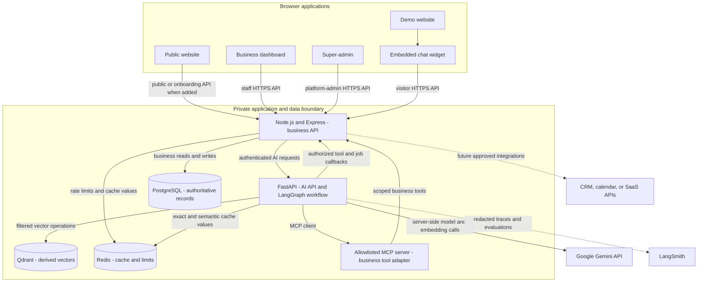
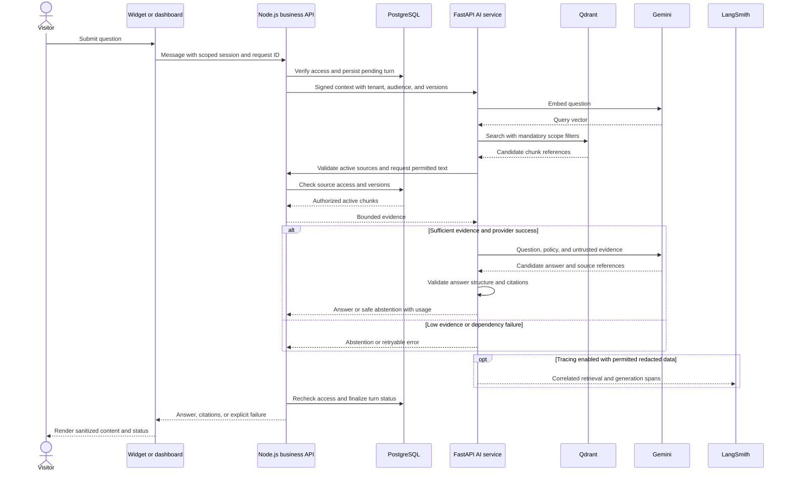
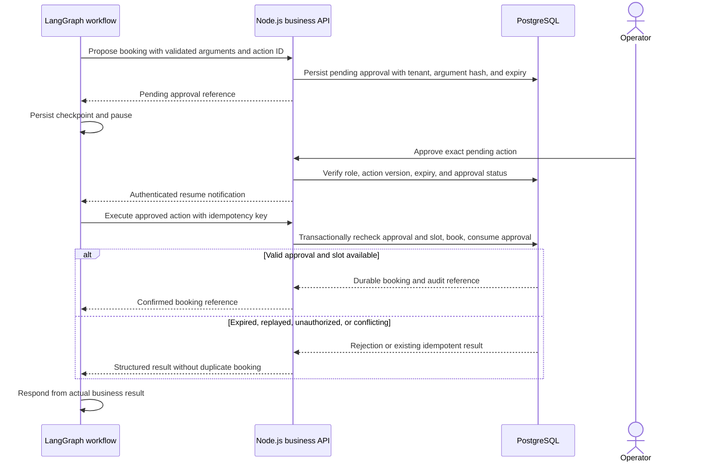

# OnusSync System Architecture

Status: proposed target architecture, not a deployed system. Phase 00 — Step 03, 27 November 2026. Foundation files and this documentation are the verified scope. A dashboard scaffold appeared during this step outside the documentation changes; it is preserved but not reviewed, run, or counted as completion of the planned application phases.

## Design approach

Start with two modular services: Node.js for business operations and FastAPI for AI operations. Keep each internally simple; do not introduce a service per feature, an API gateway product, a message broker, or a general plugin platform. Add planned components only at the roadmap step that needs them.

The design decisions below are OnusSync proposals. They do not describe another product's internal architecture.

## Application and service responsibilities

| Component | Planned responsibilities | Boundary |
| --- | --- | --- |
| `website/` | Public product information and later onboarding entry points | No staff credentials, model keys, or direct database access |
| `dashboard/` | Business/location settings, assistant and knowledge configuration, playground, conversations, leads, bookings, approvals, and basic analytics | Node.js authorizes every operation; UI visibility is not access control |
| `super-admin/` | Future platform operations, tenant lifecycle, and tightly audited support access | Separate platform permissions; no implicit access to tenant transcripts |
| `chat-widget/` | Limited visitor chat, consent prompts, booking summaries, handoff requests, and human replies | Public installation ID is not a secret; visitor session grants narrow conversation access only |
| `demo-website/` | Synthetic demonstration business hosting the widget | No real customer data; uses the same public widget contract |
| `backend/` | Express API, staff/visitor authentication, tenant/role authorization, configuration, document lifecycle, conversations, leads, booking transactions, approvals, audit, analytics, integration credentials, and webhook delivery | Authoritative business policy and all business side effects |
| `ai-backend/` | FastAPI internal API, prompt assembly, Gemini calls, parsing/chunking, embeddings, retrieval, RAG, bounded workflows, MCP client use, evaluations, and redacted traces | Cannot bypass Node.js permissions or directly mutate business tables |
| `packages/` | Small shared contracts where justified and one public branding configuration | No secrets; Python configuration remains explicit rather than requiring a shared runtime |
| `infrastructure/` | Future Docker, CI/deployment documentation and configuration when approved | Empty at this stage |
| `docs/` | Requirements, architecture, decisions, roadmap, coverage, and progress | Describes intent separately from implemented evidence |

## Planned architecture diagram

All nodes are planned components; arrows show responsibilities, not existing connectivity. Optional integrations are introduced after the core path works.

The MCP path is an adapter to the same Node.js business operations, not an independent authorization or write path. Plain tool calls use the direct AI-to-Node.js path first. LangChain is a Python integration layer within the AI service, not another network service. LangGraph controls workflow state in that service.

## Communication contracts

### Frontend to Node.js

- Use versioned HTTPS REST/JSON APIs for initial functionality, with validation, pagination, size limits, stable error codes, and request IDs. Start with a completed JSON response; add streaming only with an explicit contract for cancellation and partial output.
- The dashboard and super-admin require authenticated staff sessions. An initial plan is secure, HTTP-only cookie sessions with CSRF protection for cookie-authenticated writes. Final authentication implementation and dependency selection require approval in Phase 04.
- Widget installation IDs map to a server-controlled tenant/assistant/location configuration. A bootstrap endpoint issues a short-lived, narrowly scoped visitor token; it never exposes staff credentials. The token binds installation, tenant, assistant, session, and allowed conversation access.
- CORS/domain allowlists reduce unwanted browser use but are not identity checks. Apply server-side quotas, token validation, and conversation ownership checks even for allowed origins. A copied installation ID cannot grant private knowledge access.
- Distinguish public widget knowledge from staff-only knowledge. Enforce visibility in retrieval and source display, including in the playground when testing visitor mode.
- Proposed route families include `/api/v1/businesses`, `/assistants`, `/documents`, `/conversations`, `/leads`, `/appointments`, and `/approvals`; these are illustrative, not implemented endpoints.

### Node.js to FastAPI

- FastAPI is not a public browser API. Node.js verifies the caller, tenant membership or visitor scope, assistant, location, conversation ownership, and applicable quotas before making a private request.
- Send only the required tenant/assistant/location identifiers, conversation context, audience, active configuration and knowledge versions, allowed tool scopes, request ID, deadline, and message. Never send database credentials or let model output select a tenant.
- Use service authentication plus a short-lived signed delegation token carrying audience, expiry, and operation scopes. FastAPI validates the token and binds request fields to it. A tenant header by itself is not trusted. Use TLS outside local development and restrict network exposure.
- Define request/response schemas in both languages and use contract fixtures/tests to prevent drift; do not create a code-generation platform initially. Propagate correlation and idempotency IDs across callbacks.
- Return answer text, authorized source references, safe action results, and usage/error metadata. Node.js validates the response and verifies current resource access before persisting or returning it. Public responses must not expose internal prompts, credentials, or raw traces.
- Give each hop a deadline within the overall request budget. Retry only bounded transient operations that are safe or explicitly idempotent. Never retry business writes blindly.

### AI to business tools

The AI service receives only approved tool schemas. Gemini may propose a tool name and arguments; the server validates them. Node.js checks scoped service identity, tenant, caller authority, resource ownership, approval, business constraints, and idempotency before executing a side effect. Tool descriptions and model output do not grant privileges. MCP will later expose this same controlled interface through a standard protocol.

## Data ownership and persistence

| Store | Planned content and owner | Consistency / isolation rule |
| --- | --- | --- |
| PostgreSQL | Node.js owns tenants, global user identities and memberships, locations, assistant versions, bounded document text and chunks, ingestion jobs, conversations, leads, slots/bookings, approvals, and audit events | Authoritative transactions and relational constraints; tenant-owned queries and relationships are tenant-scoped |
| PostgreSQL workflow state | Python may later use a separately permissioned schema/role for LangGraph checkpoints and execution state | This role cannot modify business tables; checkpoint/thread lookup includes tenant and conversation ownership |
| Qdrant | Python owns embeddings plus minimal tenant, assistant, visibility, location, document/chunk version, and provenance metadata | Derived and rebuildable; mandatory filters and active-version checks on retrieval, update, and deletion |
| Redis | Node.js and Python use separate key namespaces for temporary counters, configuration/response cache, and semantic-cache values | Tenant/assistant/audience/version scope; TTLs; never authoritative for bookings or approvals |
| LangSmith | Redacted traces and evaluation artifacts from the AI service | External data boundary; opt-in configuration, minimal metadata, restricted access, and explicit retention decisions |

PostgreSQL [transactions](https://www.postgresql.org/docs/current/tutorial-transactions.html) support the proposed all-or-nothing booking operation. Start with fixed-duration slots and a tenant/resource/slot uniqueness constraint; perform confirmation and audit/idempotency updates transactionally. Expiry and approval checks occur inside the final business operation. Variable-length scheduling is deferred.

For tenant isolation, use explicit application filters and tenant-consistent constraints from the first persisted feature. Add and test PostgreSQL [row-level security](https://www.postgresql.org/docs/current/ddl-rowsecurity.html) as defense in depth before public release; account for privileged roles and table-owner bypass behavior rather than assuming RLS applies automatically. Qdrant [multitenancy](https://qdrant.tech/documentation/manage-data/multitenancy/) and [payload filtering](https://qdrant.tech/documentation/search/filtering/) support scoped vector access, but OnusSync must enforce filters on every code path.

## Document ingestion and RAG data flow

1. Node.js validates membership, document size/type, assistant ownership, and visibility; it stores bounded text and a versioned job in PostgreSQL. MVP supports text/Markdown, not remote crawling or executable content.
2. A worker in the existing Python service requests a leased job through Node.js. The job survives process restart; do not rely on a request-scoped background task for durable ingestion. Node.js remains the business database interface.
3. Python normalizes and chunks the content using a versioned strategy, generates embeddings through the configured Gemini embedding model, and upserts deterministic, tenant/version-scoped point IDs into Qdrant. Store normalized text/chunk metadata through internal Node.js endpoints.
4. Persist embedding model identifier, dimensionality, and preprocessing/chunking versions. A model or dimension change requires a separately indexed collection/version and validation before switching; never mix incompatible vector spaces. Qdrant stores/searches vectors; the embedding model generates them. See [Gemini embeddings](https://ai.google.dev/gemini-api/docs/embeddings).
5. Python reports completion; Node.js verifies the job version and activates the new knowledge revision. Failure leaves a retriable failed job; partial indexes are not public. Leases, bounded retries, and deterministic upserts make restart/reprocessing safe.
6. At query time, embed the question, search only authorized active knowledge, and validate candidate source IDs/versions with Node.js before prompt assembly. Keep the candidate count/context bounded; include citations. Low evidence triggers abstention or handoff, not invented facts.
7. Replacement/deletion updates authoritative visibility first, invalidates caches, and queues cleanup of old vectors. Until cleanup succeeds, active-version/access checks prevent stale vectors from becoming evidence. Authorization must also be rechecked for cache hits and source downloads.

Use an initially simple database-backed job lease/polling mechanism through the two services; choose a queue library or separate worker process only when volume justifies it. No Kafka or additional broker is selected.

## Chat request sequence

The following sequence describes a future cache-miss RAG request. Cache hits must pass the same current authorization and version checks before bypassing retrieval/generation.

## Agents, memory, and approval flow

Start with direct Gemini API calls so prompt construction and failure modes are visible. Introduce LangChain for reusable model/retrieval/tool integrations after the explicit RAG path is understood. Use one LangGraph state machine when bounded branching, checkpoints, and approval resumption are needed. LangGraph supports stateful orchestration and human intervention; it does not require a multi-agent design. See [LangChain](https://docs.langchain.com/oss/python/langchain/overview) and [LangGraph](https://docs.langchain.com/oss/python/langgraph/overview).

Conversation history is short-term memory with a bounded context budget. PostgreSQL messages are authoritative; checkpoints hold workflow progress, not new business truth. Optional longer-term preferences require consent, TTL/deletion, tenant scope, and provenance. Do not persist hidden model reasoning; store concise decisions, tool outcomes, and audit references. Optional multi-agent experiments use the same LangGraph runtime with bounded roles and budgets, not an additional framework.

An approval is not a long-running open HTTP connection. Persist it, return pending status, and resume via an authenticated operation. Restart recovery reconciles pending approvals and checkpoints; duplicate resume events are harmless. Visitor consent/confirmation is distinct from authorized operator approval. Changing arguments requires a new approval.

Human handoff is also distinct from a tool approval: it changes conversation ownership to a human, pauses AI generation, and allows an authorized operator to reply. Returning to AI mode requires an explicit action.

## Caching and rate limiting

- Add exact caching before semantic caching. Redis is a disposable key/value cache and shared counter store; see its [data types](https://redis.io/docs/latest/develop/data-types/). Use TTLs, bounded entry sizes, invalidation, and concurrency-safe rate-limit updates.
- Exact keys include tenant, assistant, audience/permission scope, location, configuration/knowledge/model/prompt versions, and relevant conversation state. Never share private answers between tenants or visitor sessions.
- For semantic caching, reuse Qdrant for a separate scoped cache-vector collection and store answer values/expiry in Redis. This is an OnusSync design proposal, not a requirement for Redis vector features or another vector database.
- Cache only public, non-personalized informational answers after evaluation. Require compatible scope/version filters, a measured similarity threshold, live Redis TTL, and current source authorization. Dynamic availability, leads, bookings, approvals, and tool results bypass semantic caching.
- Deletion/version changes invalidate entries and their semantic candidates. Redis misses/outages trigger safe recomputation; sensitive public endpoints fail closed if enforceable shared rate limiting is unavailable. Do not silently permit unlimited model or write calls.

## MCP, monitoring, and external boundaries

The AI backend will be the [MCP host/client](https://modelcontextprotocol.io/docs/learn/architecture) for one allowlisted demonstration tool server. Introduce a thin adapter around the existing Node.js tool contract. Server identity, allowed tools, argument validation, tenant delegation, network egress restrictions, timeouts, and approvals remain application responsibilities. Do not accept arbitrary tenant-supplied server URLs or forward credentials across services without explicit scoping.

[LangSmith tracing](https://docs.langchain.com/langsmith/observability) will correlate model, retrieval, graph, and tool spans; [evaluation](https://docs.langchain.com/langsmith/evaluation) will compare versioned datasets and experiments. Redact prompts, personal data, documents, and secrets before external export. Disable or buffer bounded telemetry safely during an outage; observability failure must not stop a correct business transaction. Trace access is not equivalent to tenant UI access.

## Failure handling and security checks

| Failure / threat | Planned response |
| --- | --- |
| Invalid identity, role, tenant, audience, or source | Deny before data retrieval/tool execution; return safe errors and record a minimal audit event |
| Prompt injection in messages, documents, tool descriptions, or tool output | Treat content as untrusted data; keep policy/tool permissions outside prompts; enforce schemas, scopes, budgets, and approvals server-side |
| Model timeout, quota, or malformed output | Bound retries, validate output, return retryable failure/abstention; never fabricate an answer or successful action |
| Weak evidence or invalid citations | Remove unsupported claims or abstain; distinguish retrieval failure from a supported negative answer |
| PostgreSQL unavailable | Fail business reads/writes explicitly; never confirm leads/bookings from cache or model text |
| Qdrant unavailable or partially indexed | Do not provide purportedly grounded answers without evidence; show unavailable/failed indexing status and retain retryable jobs |
| Cache unavailable/stale | Bypass answer cache with current access checks; apply the rate-limit failure policy above |
| Partial cross-store operation | Track job/version state in PostgreSQL; activate only successful versions; retry derived writes/cleanup idempotently without claiming a distributed transaction |
| Duplicate message, tool call, resume, or webhook | Stable idempotency/delivery IDs and database constraints; return prior authorized results rather than repeat side effects |
| Unsafe upload, HTML output, or arbitrary URL | Enforce bounded supported formats, escape/sanitize rendered content, and disallow arbitrary fetches. Future crawling requires SSRF defenses and a separate scope. |
| External integration failure | Store pending/failed delivery state; bounded retries and replay protection; never claim the downstream system accepted an unconfirmed write |

Before public release, verify tenant isolation across PostgreSQL, Qdrant, Redis, traces, checkpoint lookup, tool calls, and source access. Add secret rotation, backup restoration, tested deletion, and deployment/rollback checks. No compliance certification or production security guarantee is implied by this design.

## Deferred decisions

Package versions, authentication libraries, database access libraries, migration/test tooling, model IDs and embedding dimensions, numerical quality/latency budgets, cloud provider, and retention periods will be chosen at their approved implementation steps. Do not add Kubernetes, new databases, alternative agent frameworks, or cloud-specific services merely for interview coverage. See [roadmap](ROADMAP.md) and [requirements](REQUIREMENTS.md).
